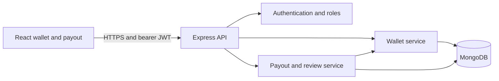

# Database and transaction architecture

## Collections

| Model | Purpose | Keys and indexes |
| --- | --- | --- |
| User | Identity, role, status, verification, region, and session version | Unique email |
| Wallet | Current integer balance for each currency | ID matches the user ID |
| WalletTransaction | Credit or debit with source, reference, and before/after balances | User/date/ID for history. Unique user/source/reference/currency/direction. |
| PayoutMethod | Availability, destination type, and supported regions | Method slug |
| PayoutOption | Denomination in INR minor units and cost in wallet credits | Option slug. Method/availability/denomination for catalog reads. |
| Withdrawal | Accepted quote, encrypted destination, status, and debit or reversal references | Unique user/idempotency key. User/date and status/date for history and review. |
| WithdrawalIntent | Fingerprint and state of a prepared withdrawal | Unique user/key. TTL removes intents after their submission deadline. |
| AuditLog | Actor, action, target, timestamp, and review notes | Target/date and reference/date |
| RequestBudget | Login, demo signup, and mutation limits | Bucket ID. TTL expires completed windows. |

## Accounting and state transitions

The balance for each currency equals posted credits minus posted debits. Demo signup creates the wallet and its opening credits in one transaction. Reconciliation compares the stored balance with ledger totals using the same database snapshot.

On withdrawal, the API checks the account and catalog, validates the quote, and deducts credits immediately. The conditional balance update, ledger entry, audit events, and pending withdrawal commit in one transaction. Each retry after a write conflict must pass the balance check again.

| Current status | Allowed next status | Wallet effect |
| --- | --- | --- |
| New | `PENDING` | Debit the full configured cost |
| `PENDING` | `PROCESSING` | None |
| `PROCESSING` | `APPROVED` | None |
| `PENDING` or `PROCESSING` | `REJECTED` or `CANCELLED` | Return the original currency and amount through one reversal credit |

Review rechecks eligibility before processing or approval. Reversals commit with the status update, and repeated decisions return the existing result. Credits leave room for outstanding refunds within the safe integer limit. Review actions and private notes are available to administrators in the withdrawal history.

Before submitting, the browser binds an idempotency key to a fingerprint of the quote and destination. A retry returns the committed receipt or checks the same fingerprint before debiting. Discard and debit update the same intent, so a discard that arrives after a debit returns its receipt.

## Security

- JWTs scope wallet actions to the signed-in account. The API verifies the account role and session version. Sign-out and password rotation revoke issued tokens. Changes to a role made directly in MongoDB must also advance the session version.
- The API validates request shapes, amounts, origins, and body sizes. Shared rate limits cover login, demo signup, withdrawals, and administrative actions.
- Withdrawal details use AES-256-GCM, bound to the withdrawal ID. New demo withdrawals store an encrypted sandbox marker. The browser keeps the token and request key in tab storage. Audit records omit destinations.
- Administrators update catalog availability, eligibility, and pricing through audited endpoints. Seeding adds missing defaults and preserves existing settings.
